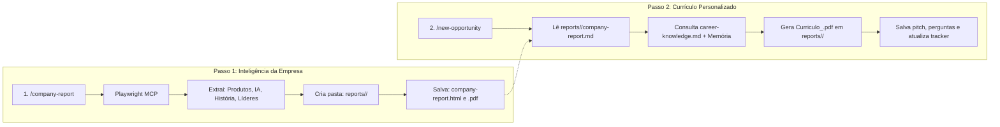

# 🎯 CV-Agents — Sistema de Inteligência de Empresas & Adaptação de Currículos com Memória Permanente

Ambiente de automação com **contexto e memória de longo prazo** para pesquisar empresas, reter aprendizados de entrevistas, gerenciar pacotes autônomos de candidatura e adaptar currículos com inteligência artificial e alta fidelidade em PDF.

---

## 🧠 Arquitetura de Memória de Longo Prazo

O `cv-agents` foi projetado para **nunca perder o contexto**, mesmo após semanas, meses, reinicializações ou compactação de sessões:

```text
c:\Projects\cv-agents\
├── AGENTS.md                           # 🏛️ REGRAS & MEMÓRIA MESTRE (Injetado automaticamente pelo Antigravity)
├── career-knowledge.md                 # 🧠 SSOT da carreira do candidato (fatos reais e métricas)
├── applications-tracker.md             # 📋 Painel mestre de candidaturas e histórico de status
├── questions-bank.md                   # ❓ Banco central de perguntas de entrevistas e formulários
├── memory/                             # 💾 MEMÓRIA VIVA & EVOLUTIVA DE LONGO PRAZO
│   ├── interview-learnings.md          # Aprendizados, perguntas reais de entrevistas e feedbacks
│   ├── salary-and-negotiations.md      # Histórico de faixas salariais, moedas (BRL/USD) e ofertas
│   └── target-preferences.md           # Preferências de carreira, stacks alvo e critérios de descarte
├── templates/                          # 🎨 Templates oficiais (Currículo A4 e Dossiê da Empresa)
├── scripts/                            # ⚙️ Scripts Playwright e geradores de PDF
└── reports/                            # 📦 Histórico autônomo de cada empresa abordada
```

> **Como o Antigravity mantém a memória:** O arquivo [`AGENTS.md`](AGENTS.md) na raiz do projeto é a instrução mandatória e permanente do ecossistema. Qualquer agente ou subagente que abrir este projeto absorve imediatamente a identidade do sistema, a localização de todas as memórias e as regras de zero alucinação.

---

## 🔄 O Fluxo de Trabalho em 2 Passos



---

### 🟢 Passo 1: `/company-report` (Dossiê da Empresa Pré-Entrevista)

```text
/company-report https://site-da-empresa.com
```

- Acessa o site institucional via **Playwright MCP**.
- Estrutura proposta de valor, produtos, IA, líderes e perguntas inteligentes para a entrevista.
- Cria a pasta dedicada em `reports/<empresa>/` com `company-report.html`, `company-report.md` e `company-report.pdf`.

---

### 🔵 Passo 2: `/new-opportunity` (Currículo & Kit Completo com Contexto Estratégico)

```text
/new-opportunity [cole a descrição da vaga aqui]
```

- **Consome o Dossiê:** Lê automaticamente `reports/<empresa>/company-report.md` (produtos, IA, momento da empresa e cultura).
- **Calibração Cirúrgica:** Alinha o Resumo Profissional e a ordem dos bullets de impacto às dores e tecnologias da empresa, utilizando **exclusivamente fatos reais** de [`career-knowledge.md`](career-knowledge.md) (zero alucinação).
- **Pitch de Abordagem & Perguntas de Triagem:** Gera abordagem personalizada para o LinkedIn citando o momento real da empresa e responde perguntas de formulário no modelo STAR.
- **Compilação Oficial:** Gera o currículo em PDF no padrão oficial A4 ([`templates/CV_English_Lucas_Camargo_QA.pdf`](templates/CV_English_Lucas_Camargo_QA.pdf)).
- **Armazenamento:** Salva todos os entregáveis (`Curriculo.pdf`, `pitch-linkedin.md`, `screening-questions.md`, `interview-prep.md`, etc.) dentro de `reports/<empresa>/` e atualiza o [`applications-tracker.md`](applications-tracker.md).

---

## 🔒 Privacidade e Segurança (.gitignore)

A pasta `reports/` e arquivos sensíveis estão no [`.gitignore`](.gitignore). Você pode versionar e publicar este projeto no GitHub com total tranquilidade, mantendo suas candidaturas e notas privadas em sigilo.
